# AsOfLab

A local-first workbench for one question:

> What could this prediction pipeline actually know at time T, and how much do
> data-timing and revision mistakes change its evaluation?

It reconstructs, from an append-only archive of observations and their
revisions, exactly what was available at each prediction time. It then measures
what happens to a model's evaluation when that is done wrong. Everything runs
on a laptop: no cloud account, no broker, no GPU, no patient data.

**All results in this repository come from simulated data.** Nothing here is
evidence about a real patient, hospital or model.

## The problem

```
08:00   blood sample drawn                  event time
09:00   model makes a prediction            prediction time
11:00   lab releases the result: 4.2        availability time
```

Build the 09:00 features by asking "what was measured before 09:00?" and the
model receives 4.2, a number nobody had for another two hours. The evaluation
then describes a pipeline that could not have existed.

Three more things make it worse in real data:

- **Corrections.** A value released at 08:30 is corrected at 12:00. The 09:00
  prediction used the original. Today's table holds the correction.
- **Retractions.** A result is withdrawn at 10:00. It was real input at 09:00.
- **Two clocks.** The lab system had the result at 08:45. The model's pipeline,
  which loads in batches, had it at 09:15.

AsOfLab writes the rules for all of this down as a
[temporal contract](docs/temporal-contract.md), and every case above is a
[handwritten fixture](src/asoflab/fixtures/cases) with the answer worked out by
hand.

```bash
uv run asoflab fixtures show delayed_result
```

## Try it

Requires Python 3.12 or later. With [uv](https://docs.astral.sh/uv/):

```bash
uv sync --all-extras --frozen
```

Without uv, `make setup` builds the same environment with pip from the
hash-pinned `requirements.lock`.

Then run the small end-to-end demonstration (under half a minute):

```bash
uv run asoflab demo
```

It runs every fixture through all three engines, simulates 600 synthetic
patients with delayed results, corrections and delayed outcomes, evaluates one
model under four time policies, audits the differences, writes a self-contained
HTML report, and checks its output against the committed reference in
[`results/demo`](results/demo).

To inspect a patient's timeline and drag the prediction time:

```bash
make ui
```

```bash
uv run asoflab serve --runs runs/demo
```

## What it found

Simulated data, generated by [a declared process](docs/statistical-methods.md)
whose parameters were fixed before any comparison was run. Seven scenarios,
five prespecified seeds each, 3,000 synthetic patients per run. All 35 runs are
reported. Full tables: [docs/results.md](docs/results.md).

| Scenario | Predictions where the naive policy read something unavailable | AUROC, naive minus as-known: mean (min to max) across 5 seeds | Seeds whose 95% interval excludes zero |
| --- | --- | --- | --- |
| Negative control: no delays, no revisions | 0.0% | 0.0000 (0.0000 to 0.0000) | 0 of 5 |
| Delayed laboratory results | 25.0% | -0.0001 (-0.0015 to +0.0014) | 0 of 5 |
| Corrections and retractions | 19.6% | +0.0018 (+0.0011 to +0.0029) | 1 of 5 |
| Delays that differ by site | 34.0% | +0.0001 (-0.0015 to +0.0014) | 0 of 5 |
| Everything combined | 46.3% | +0.0023 (-0.0005 to +0.0049) | 0 of 5 |

The same frozen model was scored on features built each way, on held-out
patients. Intervals are paired bootstraps that resample patients, not rows.

Read this plainly:

- **The negative control is exactly zero.** With nothing delayed or revised,
  every policy produces bit-identical features.
- **Contamination was common and its effect on discrimination was small.** In
  the combined scenario almost half of all predictions used something that was
  not yet available, and AUROC moved by about 0.002. How much a timing mistake
  matters depends on how informative the delayed data are. In this simulation,
  not very. A real system could differ in either direction.
- **Label timing mattered more.** With delayed outcome ascertainment, a
  pipeline that records labels the moment the horizon ends would have marked
  about 65% of the positive labels as negatives. Scoring against those labels
  lowered average precision by 0.04 to 0.10 in all ten affected runs, with every
  interval excluding zero.

A small or null effect is a result. No direction or size was expected, and
nothing was tuned to produce one.



## How it works

**Four time policies** say which clock decides "known" and which revision is read.

| Policy | What it reconstructs | Faithful replay |
| --- | --- | --- |
| `pipeline_as_known` | What the model's pipeline had | Yes |
| `source_as_known` | What the source system had | Yes |
| `latest_revised` | First availability respected, today's corrected values | No |
| `naive_event_time` | Event time only | No |

**Three engines** implement the contract with different algorithms and share
no selection code.

| Engine | Approach | Used for |
| --- | --- | --- |
| Oracle | Plain loops: every prediction against every version | Being obviously right, on small data |
| Batch | DuckDB: each version's validity interval computed once, then joined | Throughput |
| Replay | Versions fed in the order they became known, with state and checkpoints | Stream-like semantics, recovery |

They must agree exactly on identifiers, counts and last values, and within
1e-9 on means. The replay engine is a **local simulator**. It is not a
distributed stream processor.

**Validation** is built so that it can fail:

- 22 handwritten fixtures with known answers, checked against all three engines.
- 15 deliberately wrong implementations, 11 one-line SQL mutations and 3 broken
  replay states. A test requires a fixture to contradict each one.
- A random archive generator that must rediscover every seeded bug unaided. It
  did so in 10 of 10 trials for each; the slowest needed 673 archives.
- Three-engine parity and invariance properties on generated archives.
- Crash tests that kill the replay process at three points and restart it: 9 of
  9 cases ended with the same committed outputs as an uninterrupted run.

That work found real problems, each now a test: the first archive generator
was too weak to find one seeded bug, the batch backend's means differed in the
last bits from run to run, and a one-line SQL mutation survived every fixture
until a new one was written.

## Measured performance

One Apple M3 Pro laptop, synthetic workloads, median of three runs each in a
fresh process. Every measured configuration gave output equivalent to the batch
backend's. Method, all 48 rows (45 measured, 3 skipped) and the charts:
[docs/results.md](docs/results.md#3-performance).

| One million event versions, 183,351 predictions | Batch | Replay, 1 worker | Replay, 8 partitions, 4 workers |
| --- | --- | --- | --- |
| Even activity per entity | 1.18 s | 11.21 s | 3.44 s |
| Skewed: one entity holds 16% of the events | 17.84 s | 12.45 s | 4.10 s |

Neither engine wins everywhere. Batch is fastest when activity is spread
evenly. When one entity has a very large share, batch has to aggregate every
in-window observation for each of that entity's predictions, and the replay
engine, which answers counts and last values with a binary search, is faster.
At ten thousand and at a hundred thousand events, parallel replay was slower
than a single worker, because starting processes cost more than it saved.

These are measurements of a single-machine simulator. They say nothing about
any distributed system.

## Commands

| Task | Command |
| --- | --- |
| Small demonstration | `uv run asoflab demo` |
| All tests (382, about 4 minutes) | `uv run pytest -q` |
| Unit tests only | `make test-fast` |
| Benchmarks | `uv run python benchmarks/run_benchmarks.py --profile standard` |
| All scenarios and seeds | `uv run asoflab experiment matrix --out results/experiments --workers 4` |
| Rebuild the results page | `uv run python scripts/render_results.py` |
| Inspection UI | `make ui`, then `uv run asoflab serve --runs runs/demo` |
| Explain one cutoff | `uv run asoflab explain --help` |
| Show the batch SQL | `uv run asoflab sql --config examples/features.json` |

## Documentation

| Document | Contents |
| --- | --- |
| [temporal-contract.md](docs/temporal-contract.md) | The specification: records, policies, boundaries, labels |
| [architecture.md](docs/architecture.md) | The three engines, state and memory, recovery, design decisions |
| [statistical-methods.md](docs/statistical-methods.md) | Estimand, simulation, splits, bootstrap, what the intervals cover |
| [results.md](docs/results.md) | Every table and chart, generated from `results/` |
| [claims-ledger.md](docs/claims-ledger.md) | Each public number mapped to its file, command and commit |
| [prior-art.md](docs/prior-art.md) | Existing work, with sources and explicit unknowns |
| [limitations.md](docs/limitations.md) | What this does not do or show |
| [reproducibility.md](docs/reproducibility.md) | How to reproduce, and how exactly |
| [article.md](docs/article.md) | A short technical write-up |
| [interview-guide.md](docs/interview-guide.md) | How to explain and defend each part |
| [progress.md](docs/progress.md) | What was run, where, and what is still open |

## Limits

- Synthetic data only. Effect sizes belong to the simulation.
- Not a general leakage detector. Timestamps cannot establish clinical
  appropriateness, causality or data validity.
- The tool trusts the availability times it is given.
- Recovery guarantees cover one local SQLite file, not end-to-end delivery.
- Bootstrap intervals are conditional on the fitted models.

More in [limitations.md](docs/limitations.md).

## Related work and credit

Point-in-time joins, bitemporal modelling and leakage checks already exist, and
this project claims none of them as new. Feast has had an opt-in
created-timestamp filter since v0.66.0. Version-aware backtesting is
established practice in epidemiological and economic forecasting.
[prior-art.md](docs/prior-art.md) lists what was found and what could not be
verified. In an optional [comparison with Feast](integrations/feast/README.md),
using Feast's DuckDB offline store, the two agree on every prediction inside the
semantics they share.

The replay design was inspired by Stefan Vercillo's article
["Parallelizing High-Lag Backfills with Flink"](https://stefanvercillo.com/blog/archive-replay).
No code from it is used, no comparison with it is made, and there is no
collaboration with or endorsement by its author.

## License

Apache License 2.0. See [LICENSE](LICENSE) and [NOTICE](NOTICE).
