# Results

Generated by `scripts/render_results.py` from the files under `results/`. Do not edit by hand: change the code or rerun the commands, then regenerate.

All data are synthetic. Performance figures come from one development machine. [claims-ledger.md](claims-ledger.md) maps each public claim to a row here.

## 1. Validation

### Seeded bugs in the selection logic

15 deliberately wrong implementations. "Fixtures" is how many handwritten fixtures contradict the bug. "Found" is how many independent random searches produced an archive that exposes it within 4,000 generated archives; the next two columns are how many archives the search needed.

| Bug | What it gets wrong | Fixtures | Found | Median archives | Worst case |
| --- | --- | --- | --- | --- | --- |
| `arrival_order_resolution` | Lets the most recently arrived version win over a higher revision. | 2 | 10 of 10 | 110 | 284 |
| `count_every_version` | Treats every version row as a separate observation. | 8 | 10 of 10 | 60.5 | 117 |
| `cross_entity_read` | Reads every entity's events for each prediction. | 2 | 10 of 10 | 27.5 | 79 |
| `drop_empty_predictions` | Omits predictions that have no eligible observation. | 7 | 10 of 10 | 1 | 1 |
| `exclusive_availability` | Requires availability strictly before the prediction time. | 6 | 10 of 10 | 65.5 | 111 |
| `exclusive_window_end` | Uses the window (T - W, T) instead of (T - W, T]. | 1 | 10 of 10 | 70.5 | 80 |
| `first_seen_gate_latest_value` | Respects first availability but reads today's value. | 6 | 10 of 10 | 90 | 214 |
| `first_version_wins` | Never applies corrections. | 7 | 10 of 10 | 60.5 | 117 |
| `ignore_availability` | Uses event time alone and ignores availability. | 13 | 10 of 10 | 25.5 | 54 |
| `ignore_retractions` | Drops retraction records, so withdrawn observations stay. | 4 | 10 of 10 | 164 | 337 |
| `inclusive_window_start` | Uses the window [T - W, T] instead of (T - W, T]. | 2 | 10 of 10 | 62.5 | 104 |
| `last_tie_lowest_id` | Breaks ties for 'last' towards the smaller logical event id. | 2 | 10 of 10 | 379.5 | 673 |
| `latest_then_filter` | Takes today's latest version, then tests whether that version was available. | 6 | 10 of 10 | 79 | 214 |
| `retraction_payload_read` | Reads the value carried on a retraction record. | 1 | 10 of 10 | 91 | 439 |
| `window_before_resolve` | Filters versions by event-time window before resolving revisions. | 4 | 10 of 10 | 79 | 207 |

Every bug found in every trial: **yes**. Largest number of archives needed in any trial: **673**. The correct control implementation was contradicted by 0 fixtures and was not flagged by the random search.

Source: `results/validation/seeded_bugs.json`. Generated 2026-10-13T05:40:54+00:00 at commit `20b67ce67ef5` by `uv run python scripts/seeded_bug_report.py --trials 10 --budget 4000`.

### One-line mutations of the batch SQL

| Mutation | Fixtures that expose it |
| --- | --- |
| `availability_ignored` | `delayed_result`, `correction_keeps_earlier_version`, `future_append_invariance` and 7 more |
| `availability_strictly_before_cutoff` | `delayed_result`, `correction_keeps_earlier_version`, `utc_equivalence` and 2 more |
| `inner_join_drops_empty_predictions` | `delayed_result`, `missing_features_preserve_spine`, `utc_equivalence` and 4 more |
| `join_ignores_entity` | `missing_features_preserve_spine`, `entity_isolation` |
| `join_ignores_event_type` | `two_types_same_window` |
| `late_lower_revision_takes_over` | `late_older_revision`, `stale_revision_after_expiry` |
| `measurement_after_cutoff_allowed` | `window_and_tie_boundaries` |
| `previous_time_bucket_not_searched` | `delayed_result`, `correction_keeps_earlier_version`, `future_append_invariance` and 4 more |
| `retraction_rows_read` | `retraction_with_payload` |
| `superseded_version_survives_takeover_instant` | `correction_keeps_earlier_version`, `retraction_known_later` |
| `window_start_inclusive` | `window_and_tie_boundaries`, `two_types_two_windows` |

### Crash and restart

One machine, one local SQLite file per partition. Each case kills the replay process outright and restarts it. This demonstrates the local recovery contract only; it is not end-to-end exactly-once delivery and says nothing about external sinks or other machines.

Workload: 20,025 event versions, 3,667 predictions, 2 partitions, 2,000 log rows per commit.

| Crash point | Chunk | Exit code | Resumed from log row | Outputs equal an uninterrupted run |
| --- | --- | --- | --- | --- |
| `mid_chunk` | 0 | 86 | 0 | yes |
| `mid_chunk` | 2 | 86 | 4,000 | yes |
| `mid_chunk` | 5 | 86 | 10,000 | yes |
| `before_commit` | 0 | 86 | 0 | yes |
| `before_commit` | 2 | 86 | 4,000 | yes |
| `before_commit` | 5 | 86 | 10,000 | yes |
| `after_commit` | 0 | 86 | 2,000 | yes |
| `after_commit` | 2 | 86 | 6,000 | yes |
| `after_commit` | 5 | 86 | 12,000 | yes |

All cases recovered: **yes**.

Source: `results/validation/recovery.json`. Generated 2026-10-13T05:38:37+00:00 at commit `20b67ce67ef5` by `uv run python scripts/recovery_report.py`.

## 2. Statistical demonstration

**Simulated data.** 35 runs: 7 scenarios, each with the same prespecified seeds. Every run found under the results directory is included. None was dropped. Each seed is one simulated cohort with its own fitted models. The spread across seeds describes these simulated cohorts; it is not a confidence interval and says nothing about any real system.

Contrasts are absolute differences in the metric. Intervals are 95% patient-bootstrap intervals for one cohort with its fitted models held fixed.

### Naive minus as-known, same frozen model (experiment A)

| Scenario | Seeds | AUROC difference: mean (min to max) across seeds | Seeds with interval above / including / below zero | Revision effect, mean | Availability effect, mean | Predictions with a finding, mean |
| --- | --- | --- | --- | --- | --- | --- |
| `negative_control` | 5 | 0.0000 (0.0000 to 0.0000) | 0 / 5 / 0 | 0.0000 | 0.0000 | 0.0% |
| `delayed_labs` | 5 | -0.0001 (-0.0015 to +0.0014) | 0 / 5 / 0 | 0.0000 | -0.0001 | 25.0% |
| `corrections` | 5 | +0.0018 (+0.0011 to +0.0029) | 1 / 4 / 0 | +0.0018 | 0.0000 | 19.6% |
| `delayed_outcomes` | 5 | 0.0000 (0.0000 to 0.0000) | 0 / 5 / 0 | 0.0000 | 0.0000 | 0.0% |
| `multiple_encounters` | 5 | 0.0000 (0.0000 to 0.0000) | 0 / 5 / 0 | 0.0000 | 0.0000 | 0.0% |
| `site_variation` | 5 | +0.0001 (-0.0015 to +0.0014) | 0 / 5 / 0 | 0.0000 | +0.0001 | 34.0% |
| `combined` | 5 | +0.0023 (-0.0005 to +0.0049) | 0 / 5 / 0 | +0.0013 | +0.0010 | 46.3% |

The share of predictions with a finding counts predictions where the naive policy read at least one observation, or one revision, that the as-known policy says was not available.

### Scenario `negative_control`

No delays, no revisions, one encounter per patient. Every policy must agree.

| Seed | Test patients | Predictions | Events | AUROC, as-known | AUROC, naive minus as-known | Average precision, naive minus as-known | Brier, naive minus as-known | Predictions with a finding | Engines agree |
| --- | --- | --- | --- | --- | --- | --- | --- | --- | --- |
| 20261 | 587 | 8,432 | 429 | 0.717 (0.678 to 0.758) | 0.0000 (0.0000 to 0.0000) | 0.0000 (0.0000 to 0.0000) | 0.00000 (0.00000 to 0.00000) | 0.0% | yes |
| 20262 | 589 | 8,914 | 354 | 0.704 (0.662 to 0.745) | 0.0000 (0.0000 to 0.0000) | 0.0000 (0.0000 to 0.0000) | 0.00000 (0.00000 to 0.00000) | 0.0% | yes |
| 20263 | 589 | 8,907 | 398 | 0.666 (0.623 to 0.707) | 0.0000 (0.0000 to 0.0000) | 0.0000 (0.0000 to 0.0000) | 0.00000 (0.00000 to 0.00000) | 0.0% | yes |
| 20264 | 589 | 8,836 | 388 | 0.706 (0.663 to 0.747) | 0.0000 (0.0000 to 0.0000) | 0.0000 (0.0000 to 0.0000) | 0.00000 (0.00000 to 0.00000) | 0.0% | yes |
| 20265 | 589 | 9,018 | 377 | 0.744 (0.703 to 0.782) | 0.0000 (0.0000 to 0.0000) | 0.0000 (0.0000 to 0.0000) | 0.00000 (0.00000 to 0.00000) | 0.0% | yes |

Experiment B, AUROC, mean across seeds (min to max): what a naive pipeline reports minus what its model delivers on as-known features 0.0000 (0.0000 to 0.0000); as-known training minus naive training, both on as-known features 0.0000 (0.0000 to 0.0000).

### Scenario `delayed_labs`

Laboratory results become available after a delay. Nothing else is on.

| Seed | Test patients | Predictions | Events | AUROC, as-known | AUROC, naive minus as-known | Average precision, naive minus as-known | Brier, naive minus as-known | Predictions with a finding | Engines agree |
| --- | --- | --- | --- | --- | --- | --- | --- | --- | --- |
| 20261 | 587 | 8,432 | 429 | 0.717 (0.677 to 0.758) | -0.0008 (-0.0037 to +0.0019) | +0.0031 (-0.0018 to +0.0094) | -0.00007 (-0.00015 to 0.00000) | 24.9% | yes |
| 20262 | 589 | 8,914 | 354 | 0.703 (0.663 to 0.743) | +0.0014 (-0.0004 to +0.0033) | +0.0002 (-0.0010 to +0.0013) | +0.00002 (-0.00002 to +0.00005) | 25.0% | yes |
| 20263 | 589 | 8,907 | 398 | 0.664 (0.622 to 0.705) | +0.0007 (-0.0004 to +0.0017) | +0.0001 (-0.0027 to +0.0041) | 0.00000 (-0.00005 to +0.00004) | 25.2% | yes |
| 20264 | 589 | 8,836 | 388 | 0.706 (0.664 to 0.747) | -0.0003 (-0.0016 to +0.0012) | +0.0040 (-0.0016 to +0.0105) | -0.00003 (-0.00012 to +0.00003) | 24.9% | yes |
| 20265 | 589 | 9,018 | 377 | 0.746 (0.706 to 0.783) | -0.0015 (-0.0042 to +0.0013) | +0.0007 (-0.0036 to +0.0048) | -0.00003 (-0.00009 to +0.00003) | 24.9% | yes |

Experiment B, AUROC, mean across seeds (min to max): what a naive pipeline reports minus what its model delivers on as-known features 0.0000 (-0.0016 to +0.0022); as-known training minus naive training, both on as-known features 0.0000 (-0.0011 to +0.0011).

### Scenario `corrections`

Some observations are later corrected or withdrawn. No delays.

| Seed | Test patients | Predictions | Events | AUROC, as-known | AUROC, naive minus as-known | Average precision, naive minus as-known | Brier, naive minus as-known | Predictions with a finding | Engines agree |
| --- | --- | --- | --- | --- | --- | --- | --- | --- | --- |
| 20261 | 587 | 8,432 | 429 | 0.717 (0.677 to 0.758) | +0.0011 (-0.0026 to +0.0046) | -0.0067 (-0.0142 to +0.0010) | +0.00009 (-0.00004 to +0.00028) | 19.6% | yes |
| 20262 | 589 | 8,914 | 354 | 0.705 (0.665 to 0.745) | +0.0012 (-0.0024 to +0.0056) | -0.0005 (-0.0037 to +0.0015) | +0.00001 (-0.00006 to +0.00008) | 19.7% | yes |
| 20263 | 589 | 8,907 | 398 | 0.662 (0.619 to 0.703) | +0.0029 (+0.0003 to +0.0055) | +0.0018 (-0.0016 to +0.0064) | -0.00009 (-0.00018 to 0.00000) | 19.9% | yes |
| 20264 | 589 | 8,836 | 388 | 0.703 (0.660 to 0.743) | +0.0014 (-0.0015 to +0.0043) | +0.0063 (+0.0009 to +0.0119) | -0.00009 (-0.00018 to -0.00001) | 19.5% | yes |
| 20265 | 589 | 9,018 | 377 | 0.742 (0.701 to 0.781) | +0.0023 (-0.0001 to +0.0050) | +0.0001 (-0.0038 to +0.0049) | -0.00001 (-0.00006 to +0.00004) | 19.3% | yes |

Experiment B, AUROC, mean across seeds (min to max): what a naive pipeline reports minus what its model delivers on as-known features +0.0019 (+0.0013 to +0.0032); as-known training minus naive training, both on as-known features +0.0001 (-0.0017 to +0.0023).

### Scenario `delayed_outcomes`

Outcomes are ascertained after a delay. Features are unaffected.

| Seed | Test patients | Predictions | Events | AUROC, as-known | AUROC, naive minus as-known | Average precision, naive minus as-known | Brier, naive minus as-known | Predictions with a finding | Engines agree |
| --- | --- | --- | --- | --- | --- | --- | --- | --- | --- |
| 20261 | 587 | 8,432 | 429 | 0.717 (0.678 to 0.758) | 0.0000 (0.0000 to 0.0000) | 0.0000 (0.0000 to 0.0000) | 0.00000 (0.00000 to 0.00000) | 0.0% | yes |
| 20262 | 589 | 8,914 | 354 | 0.704 (0.662 to 0.745) | 0.0000 (0.0000 to 0.0000) | 0.0000 (0.0000 to 0.0000) | 0.00000 (0.00000 to 0.00000) | 0.0% | yes |
| 20263 | 589 | 8,907 | 398 | 0.666 (0.623 to 0.707) | 0.0000 (0.0000 to 0.0000) | 0.0000 (0.0000 to 0.0000) | 0.00000 (0.00000 to 0.00000) | 0.0% | yes |
| 20264 | 589 | 8,836 | 388 | 0.706 (0.663 to 0.747) | 0.0000 (0.0000 to 0.0000) | 0.0000 (0.0000 to 0.0000) | 0.00000 (0.00000 to 0.00000) | 0.0% | yes |
| 20265 | 589 | 9,018 | 377 | 0.744 (0.703 to 0.782) | 0.0000 (0.0000 to 0.0000) | 0.0000 (0.0000 to 0.0000) | 0.00000 (0.00000 to 0.00000) | 0.0% | yes |

Experiment B, AUROC, mean across seeds (min to max): what a naive pipeline reports minus what its model delivers on as-known features 0.0000 (0.0000 to 0.0000); as-known training minus naive training, both on as-known features 0.0000 (0.0000 to 0.0000).

Label timing: 65.3% of positive labels (min 63.5%, max 67.2%) would have been recorded as negative by a pipeline that labels the moment the horizon ends. Scoring the same predictions against those labels instead of the mature ones changes, as mean (min to max) across seeds: AUROC +0.0047 (-0.0128 to +0.0384), average precision -0.0646 (-0.0926 to -0.0426), Brier score -0.02432 (-0.02799 to -0.02168).

### Scenario `multiple_encounters`

Patients can have several encounters. No delays or revisions.

| Seed | Test patients | Predictions | Events | AUROC, as-known | AUROC, naive minus as-known | Average precision, naive minus as-known | Brier, naive minus as-known | Predictions with a finding | Engines agree |
| --- | --- | --- | --- | --- | --- | --- | --- | --- | --- |
| 20261 | 592 | 13,440 | 503 | 0.691 (0.653 to 0.731) | 0.0000 (0.0000 to 0.0000) | 0.0000 (0.0000 to 0.0000) | 0.00000 (0.00000 to 0.00000) | 0.0% | yes |
| 20262 | 594 | 14,278 | 558 | 0.733 (0.701 to 0.765) | 0.0000 (0.0000 to 0.0000) | 0.0000 (0.0000 to 0.0000) | 0.00000 (0.00000 to 0.00000) | 0.0% | yes |
| 20263 | 593 | 13,981 | 613 | 0.715 (0.680 to 0.749) | 0.0000 (0.0000 to 0.0000) | 0.0000 (0.0000 to 0.0000) | 0.00000 (0.00000 to 0.00000) | 0.0% | yes |
| 20264 | 594 | 14,033 | 634 | 0.713 (0.679 to 0.744) | 0.0000 (0.0000 to 0.0000) | 0.0000 (0.0000 to 0.0000) | 0.00000 (0.00000 to 0.00000) | 0.0% | yes |
| 20265 | 593 | 13,151 | 556 | 0.708 (0.674 to 0.741) | 0.0000 (0.0000 to 0.0000) | 0.0000 (0.0000 to 0.0000) | 0.00000 (0.00000 to 0.00000) | 0.0% | yes |

Experiment B, AUROC, mean across seeds (min to max): what a naive pipeline reports minus what its model delivers on as-known features 0.0000 (0.0000 to 0.0000); as-known training minus naive training, both on as-known features 0.0000 (0.0000 to 0.0000).

### Scenario `site_variation`

Delayed laboratory results, with measurement frequency, delays and pipeline cadence that differ by site.

| Seed | Test patients | Predictions | Events | AUROC, as-known | AUROC, naive minus as-known | Average precision, naive minus as-known | Brier, naive minus as-known | Predictions with a finding | Engines agree |
| --- | --- | --- | --- | --- | --- | --- | --- | --- | --- |
| 20261 | 587 | 8,432 | 429 | 0.717 (0.679 to 0.758) | -0.0015 (-0.0052 to +0.0020) | +0.0034 (-0.0024 to +0.0094) | -0.00007 (-0.00019 to +0.00003) | 34.1% | yes |
| 20262 | 589 | 8,914 | 354 | 0.705 (0.664 to 0.745) | +0.0014 (-0.0011 to +0.0040) | +0.0007 (-0.0014 to +0.0027) | +0.00001 (-0.00005 to +0.00007) | 33.8% | yes |
| 20263 | 589 | 8,907 | 398 | 0.657 (0.614 to 0.697) | +0.0009 (-0.0002 to +0.0020) | +0.0004 (-0.0013 to +0.0024) | -0.00001 (-0.00004 to +0.00002) | 33.9% | yes |
| 20264 | 589 | 8,836 | 388 | 0.708 (0.664 to 0.749) | -0.0005 (-0.0024 to +0.0013) | +0.0040 (-0.0025 to +0.0119) | -0.00003 (-0.00012 to +0.00004) | 34.0% | yes |
| 20265 | 589 | 9,018 | 377 | 0.757 (0.719 to 0.793) | +0.0003 (-0.0036 to +0.0044) | -0.0002 (-0.0053 to +0.0043) | -0.00002 (-0.00009 to +0.00005) | 34.0% | yes |

Experiment B, AUROC, mean across seeds (min to max): what a naive pipeline reports minus what its model delivers on as-known features +0.0003 (-0.0020 to +0.0017); as-known training minus naive training, both on as-known features -0.0001 (-0.0048 to +0.0018).

### Scenario `combined`

Everything on: delays, revisions, delayed outcomes, several encounters, site differences.

| Seed | Test patients | Predictions | Events | AUROC, as-known | AUROC, naive minus as-known | Average precision, naive minus as-known | Brier, naive minus as-known | Predictions with a finding | Engines agree |
| --- | --- | --- | --- | --- | --- | --- | --- | --- | --- |
| 20261 | 592 | 13,440 | 503 | 0.689 (0.648 to 0.729) | +0.0049 (-0.0002 to +0.0096) | -0.0027 (-0.0144 to +0.0062) | -0.00003 (-0.00012 to +0.00007) | 46.2% | yes |
| 20262 | 594 | 14,278 | 558 | 0.734 (0.702 to 0.767) | +0.0030 (-0.0005 to +0.0064) | -0.0024 (-0.0096 to +0.0052) | +0.00001 (-0.00007 to +0.00010) | 46.2% | yes |
| 20263 | 593 | 13,981 | 613 | 0.712 (0.678 to 0.746) | +0.0020 (-0.0009 to +0.0047) | +0.0055 (+0.0013 to +0.0120) | -0.00008 (-0.00014 to -0.00003) | 46.4% | yes |
| 20264 | 594 | 14,033 | 634 | 0.703 (0.669 to 0.737) | +0.0021 (-0.0011 to +0.0052) | +0.0111 (0.0000 to +0.0207) | -0.00018 (-0.00042 to -0.00001) | 45.9% | yes |
| 20265 | 593 | 13,151 | 556 | 0.712 (0.679 to 0.746) | -0.0005 (-0.0048 to +0.0035) | +0.0027 (-0.0034 to +0.0087) | -0.00005 (-0.00017 to +0.00006) | 46.4% | yes |

Experiment B, AUROC, mean across seeds (min to max): what a naive pipeline reports minus what its model delivers on as-known features +0.0024 (+0.0002 to +0.0051); as-known training minus naive training, both on as-known features +0.0004 (-0.0015 to +0.0016).

Label timing: 65.4% of positive labels (min 64.1%, max 65.9%) would have been recorded as negative by a pipeline that labels the moment the horizon ends. Scoring the same predictions against those labels instead of the mature ones changes, as mean (min to max) across seeds: AUROC -0.0010 (-0.0208 to +0.0215), average precision -0.0754 (-0.0955 to -0.0567), Brier score -0.02309 (-0.02443 to -0.02098).

Source: `results/experiments/summary.json` and the run directories beside it. Runs were produced at commit `20b67ce67ef5, d9f74977d0c3` by `uv run asoflab experiment matrix --out results/experiments --workers 4`. First run listed: `negative_control-seed20261-03bbda0f`.

## 3. Performance

**Synthetic workloads on one machine.** These timings describe a single-machine simulator. They are not a measurement of any distributed system, and they will differ on other hardware.

Machine: Apple M3 Pro, 11 physical cores, 18 GiB memory, macOS-14.5-arm64-arm-64bit. Python 3.12.15, DuckDB 1.5.6, PyArrow 26.0.0.

The laptop was in normal use, not isolated: its one-minute load average was 2.54 when the run started and 4.14 when it ended, on a machine with more cores than that.

Method: each run in a fresh process; one unmeasured run of each configuration before the measured repetitions; 3 measured repetitions; operating-system file cache warm: inputs are written and then read by the warm-up run; timeout 900 s; policy `pipeline_as_known`; memory: resident set size summed over the worker's process tree, sampled every 20 ms; short peaks between samples can be missed.

### Workloads

| Workload | Event versions | Entities | Largest entity's share | Predictions | Features | Input size | Generation | Write |
| --- | --- | --- | --- | --- | --- | --- | --- | --- |
| `uniform-10000` | 10,047 | 45 | 2.6% | 1,833 | 8 | 0.4 MB | 0.04 s | 0.01 s |
| `uniform-100000` | 100,033 | 458 | 0.3% | 18,335 | 8 | 3.5 MB | 0.10 s | 0.05 s |
| `uniform-1000000` | 1,000,408 | 4,583 | 0.0% | 183,351 | 8 | 29.6 MB | 1.06 s | 0.36 s |
| `zipf-10000` | 10,047 | 45 | 26.8% | 1,833 | 8 | 0.4 MB | 0.01 s | 0.01 s |
| `zipf-100000` | 100,033 | 458 | 19.4% | 18,335 | 8 | 3.5 MB | 0.10 s | 0.05 s |
| `zipf-1000000` | 1,000,408 | 4,583 | 15.9% | 183,351 | 8 | 29.2 MB | 1.01 s | 0.35 s |

### Runs

Times are seconds. "End to end" is the median over repetitions with the range in brackets, and is the sum of the three phases inside the worker process. A speedup is shown only when the output was equivalent to the batch backend's.

| Workload | Engine | End to end | Prepare | Compute | Export | Peak memory | Equivalent output | Note |
| --- | --- | --- | --- | --- | --- | --- | --- | --- |
| `uniform-10000` | batch | 0.05 (0.05 to 0.05) | 0.00 | 0.03 | 0.00 | 171 MiB | yes |  |
| `uniform-10000` | batch, no time buckets | 0.06 (0.06 to 0.06) | 0.00 | 0.03 | 0.00 | 174 MiB | yes |  |
| `uniform-10000` | replay, 1 partition, 1 worker | 0.10 (0.10 to 0.11) | 0.03 | 0.03 | 0.01 | 125 MiB | yes |  |
| `uniform-10000` | replay, 8 partitions, 1 worker | 0.12 (0.12 to 0.13) | 0.04 | 0.04 | 0.01 | 125 MiB | yes |  |
| `uniform-10000` | replay, 8 partitions, 2 workers | 0.31 (0.31 to 0.31) | 0.04 | 0.23 | 0.01 | 317 MiB | yes | 0.40x vs 1 worker |
| `uniform-10000` | replay, 8 partitions, 4 workers | 0.31 (0.31 to 0.33) | 0.04 | 0.23 | 0.01 | 498 MiB | yes | 0.40x vs 1 worker |
| `uniform-10000` | replay, 8 partitions, 8 workers | 0.40 (0.39 to 0.40) | 0.04 | 0.31 | 0.01 | 871 MiB | yes | 0.31x vs 1 worker |
| `uniform-10000` | oracle | 0.44 (0.43 to 0.44) | 0.12 | 0.32 | 0.00 | 104 MiB | yes |  |
| `uniform-100000` | batch | 0.15 (0.15 to 0.15) | 0.00 | 0.12 | 0.01 | 241 MiB | yes |  |
| `uniform-100000` | batch, no time buckets | 0.18 (0.18 to 0.18) | 0.00 | 0.15 | 0.01 | 248 MiB | yes |  |
| `uniform-100000` | replay, 1 partition, 1 worker | 0.67 (0.67 to 0.67) | 0.11 | 0.47 | 0.06 | 229 MiB | yes |  |
| `uniform-100000` | replay, 8 partitions, 1 worker | 0.55 (0.54 to 0.55) | 0.13 | 0.32 | 0.05 | 193 MiB | yes |  |
| `uniform-100000` | replay, 8 partitions, 2 workers | 0.60 (0.60 to 0.61) | 0.13 | 0.37 | 0.06 | 402 MiB | yes | 0.91x vs 1 worker |
| `uniform-100000` | replay, 8 partitions, 4 workers | 0.55 (0.54 to 0.56) | 0.14 | 0.31 | 0.06 | 600 MiB | yes | 1.00x vs 1 worker |
| `uniform-100000` | replay, 8 partitions, 8 workers | 0.62 (0.61 to 0.62) | 0.14 | 0.38 | 0.06 | 989 MiB | yes | 0.89x vs 1 worker |
| `uniform-100000` | oracle | 5.39 (5.38 to 5.48) | 1.12 | 4.27 | 0.01 | 365 MiB | yes |  |
| `uniform-1000000` | batch | 1.17 (1.16 to 1.21) | 0.00 | 1.09 | 0.06 | 671 MiB | yes |  |
| `uniform-1000000` | batch, no time buckets | 1.78 (1.77 to 1.80) | 0.00 | 1.70 | 0.06 | 654 MiB | yes |  |
| `uniform-1000000` | replay, 1 partition, 1 worker | 11.06 (11.03 to 11.13) | 0.40 | 10.07 | 0.55 | 907 MiB | yes |  |
| `uniform-1000000` | replay, 8 partitions, 1 worker | 6.24 (6.23 to 6.29) | 0.69 | 4.97 | 0.56 | 583 MiB | yes |  |
| `uniform-1000000` | replay, 8 partitions, 2 workers | 4.11 (4.10 to 4.16) | 0.69 | 2.82 | 0.56 | 830 MiB | yes | 1.52x vs 1 worker |
| `uniform-1000000` | replay, 8 partitions, 4 workers | 3.10 (3.09 to 3.13) | 0.68 | 1.82 | 0.56 | 1,161 MiB | yes | 2.01x vs 1 worker |
| `uniform-1000000` | replay, 8 partitions, 8 workers | 3.00 (3.00 to 3.02) | 0.69 | 1.71 | 0.56 | 1,725 MiB | yes | 2.08x vs 1 worker |
| `uniform-1000000` | oracle | **skipped** |  |  |  |  |  | The oracle compares every prediction with every version of its entity. It is a correctness reference and was not attempted at this size. |
| `zipf-10000` | batch | 0.06 (0.06 to 0.06) | 0.00 | 0.03 | 0.00 | 174 MiB | yes |  |
| `zipf-10000` | batch, no time buckets | 0.07 (0.07 to 0.07) | 0.00 | 0.04 | 0.00 | 174 MiB | yes |  |
| `zipf-10000` | replay, 1 partition, 1 worker | 0.11 (0.11 to 0.11) | 0.03 | 0.04 | 0.01 | 125 MiB | yes |  |
| `zipf-10000` | replay, 8 partitions, 1 worker | 0.13 (0.13 to 0.13) | 0.04 | 0.05 | 0.01 | 126 MiB | yes |  |
| `zipf-10000` | replay, 8 partitions, 2 workers | 0.31 (0.31 to 0.31) | 0.04 | 0.23 | 0.01 | 319 MiB | yes | 0.43x vs 1 worker |
| `zipf-10000` | replay, 8 partitions, 4 workers | 0.31 (0.31 to 0.32) | 0.04 | 0.23 | 0.01 | 497 MiB | yes | 0.42x vs 1 worker |
| `zipf-10000` | replay, 8 partitions, 8 workers | 0.40 (0.40 to 0.40) | 0.04 | 0.32 | 0.01 | 848 MiB | yes | 0.33x vs 1 worker |
| `zipf-10000` | oracle | 1.68 (1.67 to 1.69) | 0.12 | 1.56 | 0.00 | 103 MiB | yes |  |
| `zipf-100000` | batch | 0.40 (0.40 to 0.40) | 0.00 | 0.37 | 0.01 | 735 MiB | yes |  |
| `zipf-100000` | batch, no time buckets | 0.92 (0.88 to 0.92) | 0.00 | 0.89 | 0.01 | 727 MiB | yes |  |
| `zipf-100000` | replay, 1 partition, 1 worker | 0.71 (0.70 to 0.71) | 0.11 | 0.51 | 0.06 | 235 MiB | yes |  |
| `zipf-100000` | replay, 8 partitions, 1 worker | 0.59 (0.58 to 0.59) | 0.14 | 0.36 | 0.06 | 197 MiB | yes |  |
| `zipf-100000` | replay, 8 partitions, 2 workers | 0.63 (0.63 to 0.63) | 0.14 | 0.39 | 0.07 | 408 MiB | yes | 0.94x vs 1 worker |
| `zipf-100000` | replay, 8 partitions, 4 workers | 0.56 (0.56 to 0.56) | 0.13 | 0.32 | 0.07 | 602 MiB | yes | 1.06x vs 1 worker |
| `zipf-100000` | replay, 8 partitions, 8 workers | 0.63 (0.63 to 0.64) | 0.13 | 0.40 | 0.07 | 989 MiB | yes | 0.93x vs 1 worker |
| `zipf-100000` | oracle | **skipped** |  |  |  |  |  | The oracle compares every prediction with every version of its entity. It is a correctness reference and was not attempted at this size. |
| `zipf-1000000` | batch | 17.59 (17.57 to 17.65) | 0.00 | 17.49 | 0.07 | 5,922 MiB | yes |  |
| `zipf-1000000` | batch, no time buckets | 51.52 (49.75 to 51.62) | 0.00 | 51.43 | 0.07 | 5,908 MiB | yes |  |
| `zipf-1000000` | replay, 1 partition, 1 worker | 12.43 (12.43 to 12.55) | 0.40 | 11.35 | 0.64 | 893 MiB | yes |  |
| `zipf-1000000` | replay, 8 partitions, 1 worker | 7.69 (7.69 to 7.72) | 0.67 | 6.36 | 0.64 | 594 MiB | yes |  |
| `zipf-1000000` | replay, 8 partitions, 2 workers | 4.90 (4.89 to 4.91) | 0.68 | 3.55 | 0.64 | 833 MiB | yes | 1.57x vs 1 worker |
| `zipf-1000000` | replay, 8 partitions, 4 workers | 3.76 (3.75 to 3.77) | 0.68 | 2.42 | 0.64 | 1,156 MiB | yes | 2.04x vs 1 worker |
| `zipf-1000000` | replay, 8 partitions, 8 workers | 4.01 (3.99 to 4.04) | 0.67 | 2.65 | 0.64 | 1,666 MiB | yes | 1.92x vs 1 worker |
| `zipf-1000000` | oracle | **skipped** |  |  |  |  |  | The oracle compares every prediction with every version of its entity. It is a correctness reference and was not attempted at this size. |

Notes from the harness:

- Single machine, synthetic data, local files. Not a measurement of any distributed system.
- The machine was a laptop with other desktop applications running. settings records the system load average at the start and end of the run.
- The oracle is a correctness reference written for clarity, not speed. Its times are shown for scale only.
- end_to_end excludes interpreter start-up; wall_seconds_with_startup includes it.
- Speedups are reported only where the outputs were equivalent to the batch backend's.
- Replay prepare (sorting and compaction) is paid once per prepared log. amortised_seconds_per_replay states the number of replays it is spread over.

Source: `results/benchmarks/standard.json`. Generated 2026-10-13T06:33:13+00:00 at commit `1624483283b9` by `uv run python benchmarks/run_benchmarks.py --profile standard`.

## 4. Demonstration run

The reference for `asoflab demo`: scenario `combined`, seed 20261, 600 simulated patients, 66,994 event versions, 13,225 predictions.

- Predictions where the naive policy read something unavailable: 6,156 of 13,225 (46.5%).
- AUROC, naive minus as-known, same frozen model: -0.0038 (-0.0103 to +0.0019) (118 test patients, 2,842 predictions, 134 events).
- Engines agree on this cohort: 8 of 8 comparisons.

Source: `results/demo/combined-seed20261-89383319/`, commit `20b67ce67ef5`, by `uv run asoflab demo --out results/demo`.

## 5. Feast comparison (optional interoperability check)

One feature ('last' value of one event type, 24 h window), Feast local file sources, synthetic data. Agreement is expected only inside the shared semantics. Differences in the case marked outside the shared semantics are unsupported semantics, not defects in Feast. Feast version 0.66.0.

| Case | Shared semantics | Feast offline store | Feast mode | AsOfLab policy | Equal | Different | Absent from Feast output |
| --- | --- | --- | --- | --- | --- | --- | --- |
| `delays_only` | yes | duckdb | default | `naive_event_time` | 4,000 | 0 | 0 |
| `delays_only` | yes | duckdb | created-timestamp filter | `pipeline_as_known` | 4,000 | 0 | 0 |
| `delays_only` | yes | dask | default | `naive_event_time` | 1,863 | 0 | 2,137 |
| `delays_only` | yes | dask | created-timestamp filter | `pipeline_as_known` | 1,863 | 0 | 2,137 |
| `corrections_in_arrival_order` | yes | duckdb | default | `naive_event_time` | 3,478 | 0 | 0 |
| `corrections_in_arrival_order` | yes | duckdb | created-timestamp filter | `pipeline_as_known` | 3,478 | 0 | 0 |
| `corrections_in_arrival_order` | yes | dask | default | `naive_event_time` | 1,600 | 96 | 1,782 |
| `corrections_in_arrival_order` | yes | dask | created-timestamp filter | `pipeline_as_known` | 1,645 | 51 | 1,782 |
| `revisions_outside_feasts_model` | no | duckdb | default | `naive_event_time` | 3,145 | 188 | 0 |
| `revisions_outside_feasts_model` | no | duckdb | created-timestamp filter | `pipeline_as_known` | 3,212 | 121 | 0 |
| `revisions_outside_feasts_model` | no | dask | default | `naive_event_time` | 1,408 | 210 | 1,715 |
| `revisions_outside_feasts_model` | no | dask | created-timestamp filter | `pipeline_as_known` | 1,473 | 145 | 1,715 |

Differences in the case outside the shared semantics are expected and are not defects. `integrations/feast/README.md` explains the mapping, and the two observations about Feast's Dask offline store that account for its other differences and its absent rows.

Source: `results/interop/feast.json`. Generated 2026-10-13T05:35:58+00:00 at commit `20b67ce67ef5` by `uv run python integrations/feast/run_comparison.py`.

### Which row wins when two rows share an event timestamp

Each entity has two feature rows with the same event timestamp. The documentation says the row with the highest created timestamp wins. Counts of which row Feast returned. Feast 0.66.0, pandas 2.3.3, dask 2026.8.0. One event time per entity, default mode. Not reported upstream.

| Offline store | Entities | Later-created row returned | Earlier-created row returned |
| --- | --- | --- | --- |
| dask | 5 | 5 | 0 |
| dask | 50 | 22 | 28 |
| dask | 500 | 253 | 247 |
| dask | 5,000 | 2,548 | 2,452 |
| duckdb | 5 | 5 | 0 |
| duckdb | 50 | 50 | 0 |
| duckdb | 500 | 500 | 0 |
| duckdb | 5,000 | 5,000 | 0 |

Source: `results/interop/feast_created_tiebreak.json`, by `integrations/feast/.venv/bin/python integrations/feast/repro_created_tiebreak.py`.
